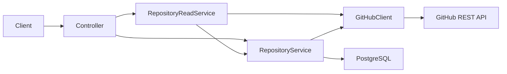

# Architecture

The application is a modular monolith. Controllers validate and translate HTTP; repository services coordinate local selection and GitHub reads; the GitHub client owns external communication; Spring Data JPA and Flyway manage local state. DTOs prevent exposing entities or GitHub's entire payload.

Registration validates input, checks duplicates, verifies access against GitHub, then stores canonical identity. Activation locks a singleton database row, clears the previous selection and activates the target in one transaction; a partial unique index provides a second safeguard. Read endpoints resolve the path ID to a registered repository, then request GitHub data. The active flag represents user selection; explicitly addressed registered repository reads do not require it to be active.

The GitHub client uses a configured base URL, no automatic redirects, timeouts, bounded lists and sanitized errors. Overview counts come from GitHub Search rather than the mixed issue/PR repository counter. Search's incomplete flag is returned. Future agent tools should use application services with the selected repository supplied by trusted backend context, treat GitHub text as untrusted, and route any writes through a separately implemented approval workflow. No agent or write tool exists in Phase 1.

The planned frontend is a React + TypeScript SPA using Vite, React Router and TanStack Query. Its feature boundaries, local API proxy and security decisions are recorded in [Frontend architecture](06-frontend-architecture.md); it has not yet been implemented.
